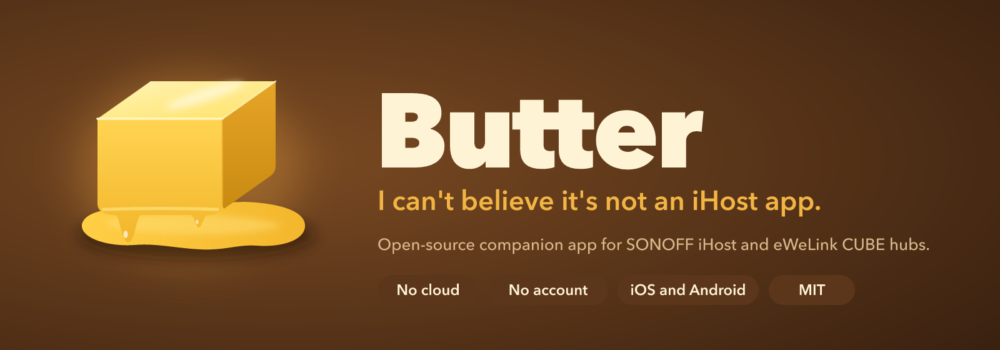
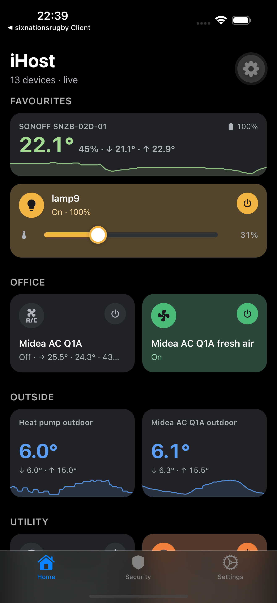
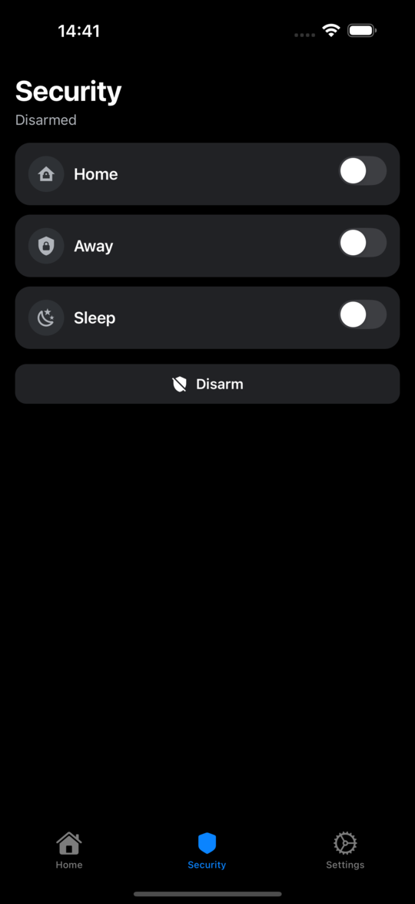
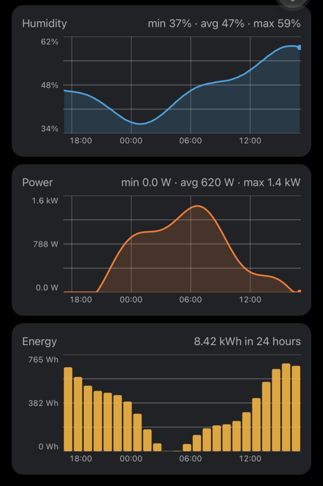
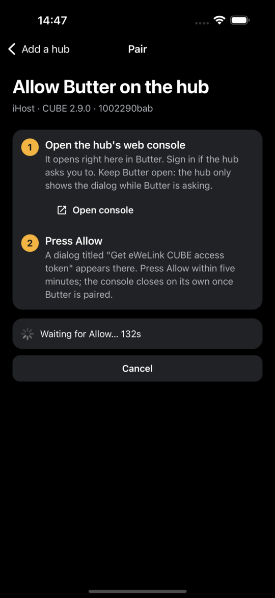

<p align="center">
  
</p>

<p align="center">
  <a href="LICENSE"></a>
  
  
  
  <a href="https://github.com/motorosgep/butter/actions/workflows/update.yml"></a>
</p>

**Butter** is an open-source phone app for homes that run on a local
[eWeLink CUBE](https://ewelink.cc/ewelink-cube/) gateway, such as the
[SONOFF iHost](https://sonoff.tech/product/smart-home-hub/ihost/). The gateway
keeps everything on your network by design, and in exchange it never got a
companion app: control happens through a web console or a wall tablet. Butter
gives it the phone app it deserves, without adding a cloud of its own.

## Why Butter

- **Talks straight to the hub.** Butter uses the gateway's own Open API over
  your network. No account, no server in the middle, nothing leaves your LAN
  unless you bring your own VPN for remote use.
- **Every device, every capability.** Tiles are generated from what the hub
  reports, so switches, plugs, lights, curtains, sensors, thermostats, air
  conditioners and devices from third-party add-ons all get a sensible card,
  including the ones vendor ecosystems leave out.
- **Live.** The hub streams state changes; tiles update the instant something
  happens, whoever caused it.
- **Honest about the hub's limits.** The Open API has no rooms or scenes yet.
  Butter keeps room assignments on the hub as device tags, so they follow you
  to every phone, and will offer app-side scenes until the API grows.
- **Opinionated only about staying out of the way.** No bloat, no upsell, no
  forced ecosystem. It is a remote control for your house.

## Screenshots

<p align="center">
  &nbsp;
  &nbsp;
  &nbsp;
  
</p>

## What works today

Butter is in early development, built and tested against a SONOFF iHost running
eWeLink CUBE 2.9. Other gateways that run eWeLink CUBE with the Open API
enabled should work too; reports are welcome.

- Finds the hub on the network (mDNS) or takes an address, including a VPN or
  remote-access URL.
- One-time pairing: press **Allow** on the hub's console and the token lives in
  the phone's secure keychain from then on.
- Home tab with a tile per device, grouped by room. Tiles take a colour while
  the device is doing something (butter for a light that is on, blue while
  cooling, orange while heating, green for a running fan, red for a leak), so
  you spot what is active without reading names. Sensor tiles show the reading
  big, coloured on a cold-to-hot scale, with today's low and high and a 24-hour
  sparkline when the history add-on is present.
- Favourites: long-press a tile (or tap the star on its page) to pin it. Pinned
  devices sit at the top of Home as wide tiles with an inline brightness or
  position slider and the climate readings. Pins are stored on the hub, so
  every phone shows the same.
- Device page with every control the hub exposes: power, multi-channel
  toggles, brightness, colour temperature, modes (fan speed, AC mode and more),
  thermostat setpoints, swings, eco, curtain position, motor control, plus
  rename and room assignment.
- Security tab for the hub's Home, Away and Sleep modes.
- History charts (24 hours, 7 days, 30 days) for temperature, humidity, power,
  battery and energy per hour or day, when the free
  [ihost-bridge](https://github.com/motorosgep/ihost-bridge#history-for-butter)
  add-on runs on the hub; the hub itself keeps history for its console only.
- Weather at home: a tile at the top of Home with current conditions, today's
  range, the next hours and your outdoor sensor's reading, plus a forecast
  screen with the next 24 hours and the week ahead. Forecasts come from
  [Open-Meteo](https://open-meteo.com/) with no API key; you pick the town
  once per hub and only its coordinates are sent.
- Measurements (Hungary): browse the records of the HungaroMet station nearest
  home, fetched straight from the service's open data portal: rainfall by day,
  month and year against the station's own long-term averages, daily and
  monthly temperatures, and the last 48 hours hour by hour. Automatic stations
  go back to 2002; the denser rain-gauge network reports rain only.
- Multiple hubs, and a built-in demo home to explore without hardware.
- Updates ship over the air, so most fixes reach you without a reinstall.

Not yet: scenes, favourites, widgets, notifications, a store listing. See the
roadmap.

## How it works

```
phone ──LAN (or VPN)──▶ gateway Open API v2   GET /open-api/v2/rest/devices
                                               PUT /open-api/v2/rest/devices/{id}
                        event stream           GET /open-api/v2/sse/bridge
```

1. **Pairing.** Butter finds the gateway (it advertises itself over mDNS) or
   you type its address. It asks the gateway for an access token and opens the
   hub's console inside the app; you press **Allow** once. The token is stored
   in the phone's secure keychain.
2. **Devices.** The device list, with categories and capabilities, becomes the
   tile grid. Rooms come from a `room` tag Butter writes on each device.
3. **Control and updates.** Commands go straight to the hub; state changes come
   back over the server-sent event stream.
4. **Remote use.** Any route that reaches the hub works: Tailscale, your own
   VPN, or CUBE's remote access link. Butter just needs a base URL.

The details of what the Open API does and does not offer are in
[docs/open-api-notes.md](docs/open-api-notes.md).

## Try it

There is no store listing yet. Until there is, build it yourself; it takes a
free [Expo](https://expo.dev) account and about fifteen minutes of waiting.

```bash
git clone https://github.com/motorosgep/butter.git
cd butter
npm install
npx eas-cli@latest login
npx eas-cli@latest build --platform ios --profile preview        # or: --platform android
```

Install the build EAS hands you (iOS needs your device registered with EAS
first, Android is a plain APK), open Butter, and follow the pairing steps.
Simulator builds use the `preview-simulator` profile.

## Development

Expo SDK 57 with Expo Router and TypeScript. The project pins the public npm
registry in `.npmrc`.

```bash
npm install
npx expo start --dev-client   # Metro for a development build
npx tsc --noEmit              # typecheck
npx expo lint                 # lint
```

Native modules (mDNS discovery, secure storage, the in-app console) need a
development build. Android builds run locally with Android Studio's SDK and a
JDK 17, using the same profiles as the cloud and costing no EAS quota:

```bash
export ANDROID_HOME=$HOME/Library/Android/sdk
export GRADLE_OPTS="-Dorg.gradle.jvmargs=-Xmx4g -XX:MaxMetaspaceSize=1536m"   # the default metaspace is too small
npx eas-cli@latest build --platform android --profile preview --local --output butter.apk      # install on a phone
npx eas-cli@latest build --platform android --profile development --local --output dev.apk     # dev client
```

SDK 57 requires Xcode 26.4 or newer for local iOS builds; without it, iOS goes
through the cloud. Batch native changes, since the Free plan allows 15 builds
per platform a month:

```bash
npx eas-cli@latest build --platform ios --profile development-simulator   # iOS Simulator
npx eas-cli@latest build --platform ios --profile development             # iPhone
```

`scripts/spike.ts` exercises the API client against a real hub from Node and
is the quickest way to poke at the Open API.

### Shipping

JavaScript and asset changes ship with EAS Update, so most releases need no new
binary and no store review. Each build profile has an update channel of the same
name (`development`, `preview`, `production`), and the runtime version is a
fingerprint of the native project. An update can only reach builds whose native
code matches, so a changed native dependency or config means one more
`eas build`; everything else is an update.

```bash
npx eas-cli@latest update --channel preview --environment preview --message "What changed"        # testers
npx eas-cli@latest update --channel production --environment production --message "What changed"  # store builds
npx eas-cli@latest update --channel development --environment development --message "..."         # dev builds (Extensions tab)
```

The Free plan allows 15 iOS and 15 Android builds a month, unlimited updates
for up to 1,000 monthly active users and 100 GiB of bandwidth. `npm run
eas:usage` prints this month's build count; the account's usage page on
expo.dev has the rest.

Pushes to `main` publish to the `preview` channel through
[`.github/workflows/update.yml`](.github/workflows/update.yml) once the
repository has an `EXPO_TOKEN` secret (expo.dev → Account settings → Access
tokens). Release builds fetch the update in the background and apply it on the
next launch.

## Roadmap

1. **MVP.** Onboarding, device tiles, controls, live updates, security modes,
   settings, multiple hubs, demo mode. Done. TestFlight and Play internal
   testing next.
2. **Rooms, favourites, scenes.** Rooms and favourites via tags: done.
   App-side scenes and local notifications while the app is open: next.
3. **Platform polish.** Widgets, Siri Shortcuts, tablet layout, translations.
4. **Assistant.** Ask the house questions and give it instructions in plain
   language.

## Contributing

Issues and pull requests are welcome, especially reports from other gateways
and device types. Run `npx tsc --noEmit` and `npx expo lint` before opening a
pull request.

## License

MIT, see [LICENSE](LICENSE).

Butter is not affiliated with SONOFF, ITEAD or CoolKit. iHost, eWeLink and
eWeLink CUBE are their trademarks; Butter just works with their gateway.
